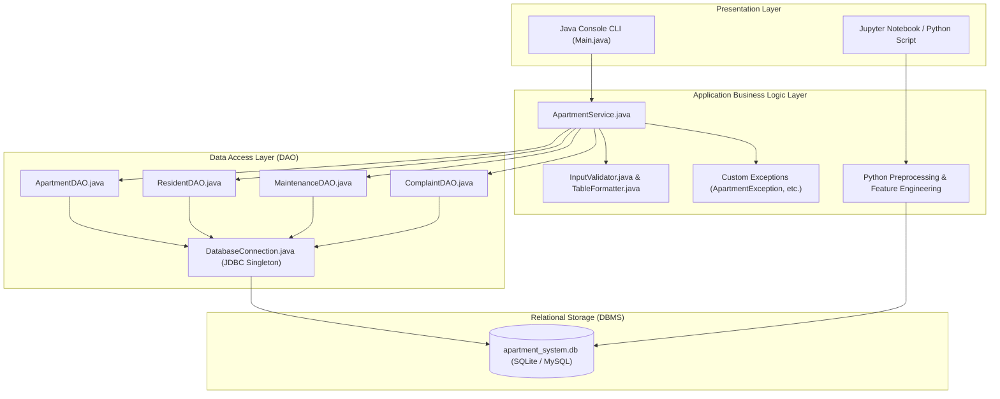

# Apartment Maintenance and Resident Complaint Management System
### Activity: Project-Based Assessment — Scenario 18
**Institution:** Velalar College of Engineering and Technology (Autonomous), Erode – 638012  
**Department:** Department of Information Technology  
**Academic Year:** 2026 - 2027 (ODD Semester) | **Class:** 25IT3A & 25IT3B  
**Target Register Numbers:** 18, 48, 78, 108  

---

## 📋 Course Syllabi Integration & Alignment

This interdisciplinary software project integrates competencies from four core curriculum courses:

| Course Code | Course Title | Syllabus Topics Implemented | Project Deliverable / Location |
|---|---|---|---|
| **25ITT31** | **Database Management Systems** | E-R Model, Relational Schema, BCNF Normalization, DDL/DML, Complex Queries, Indexes & Views | [`database/`](database/), [`docs/Database_Design_and_Normalization.md`](docs/Database_Design_and_Normalization.md) |
| **25ITT32** | **Java Programming** | OOP, Inheritance, DAO Pattern, JDBC, Custom Exceptions, Collections, Lambdas & Streams, Console I/O | [`src/com/apartment/`](src/com/apartment/) |
| **25ITT33** | **Software Engineering** | IEEE 830 SRS, Use Case Diagrams, Class Diagrams, 3-Tier Architecture, Verification & Test Cases | [`docs/SRS_Document.md`](docs/SRS_Document.md), [`docs/Design_Diagrams.md`](docs/Design_Diagrams.md), [`docs/Software_Testing_Document.md`](docs/Software_Testing_Document.md) |
| **25ITC31** | **Foundations of Data Science** | SQLite DB Extraction, Pandas Data Cleaning, Feature Engineering, EDA, Matplotlib & Seaborn Visualizations | [`python_eda/eda_visualization.py`](python_eda/eda_visualization.py), [`python_eda/eda_notebook.ipynb`](python_eda/eda_notebook.ipynb) |

---

## 🏢 Scenario 18: Problem Statement

An apartment complex manages resident details, apartment information, maintenance fee payments, and complaints related to water supply, electrical issues, cleanliness, elevators, and security. Handling these operations manually with ledgers leads to:
* Delayed grievance turnaround and lack of status visibility.
* Difficulty tracking recurring defaulters and pending maintenance collections.
* Inability to detect spatial and category-wise facility degradation hotspots.

### System Solution
An automated, robust multi-tier system developed using **Java**, an ACID-compliant **Relational DBMS (SQLite / MySQL)**, and **Python Data Science** to streamline maintenance accounting, accelerate complaint resolution lifecycles, and visually analyze operational metrics.

---

## 🛠️ System Architecture



---

## 📂 Repository File Structure

```text
dhanusree/
├── database/
│   ├── schema.sql              # DDL schema definitions, constraints, indexes & views
│   ├── seed_data.sql           # Realistic seed dataset (Apartments, Residents, Dues, Complaints)
│   ├── queries.sql             # Complex SQL queries (Joins, Aggregations, Nested Subqueries)
│   ├── init_db.py              # Automated SQLite database builder & verifier
│   └── apartment_system.db     # Populated SQLite relational database file
├── docs/
│   ├── SRS_Document.md                       # Complete IEEE 830 Standard Requirements Specification
│   ├── Design_Diagrams.md                    # Use Case, Class, Architecture & Sequence Diagrams
│   ├── Database_Design_and_Normalization.md  # ER Diagram, Relational Schema & BCNF Proofs
│   ├── Software_Testing_Document.md          # Test Strategy, Test Cases (15/15 PASS), RTM
│   └── Sample_Inputs_and_Outputs.md          # Documented terminal execution traces
├── lib/
│   └── sqlite-jdbc.jar         # SQLite JDBC Driver (v3.49.1)
├── src/
│   └── com/
│       └── apartment/
│           ├── model/          # Domain Entities (Apartment, Resident, Payment, Complaint)
│           ├── dao/            # Data Access Objects & JDBC Connection Manager
│           ├── service/        # Business Logic & Stream Aggregations
│           ├── exception/      # User-defined Custom Exceptions
│           ├── util/           # Input Validators & Table Formatter
│           └── Main.java       # Interactive Console Application Entry Point
├── python_eda/
│   ├── eda_visualization.py    # Python pipeline for data preprocessing & EDA
│   ├── eda_notebook.ipynb      # Interactive Jupyter Notebook with embedded analysis
│   └── output_visualizations/  # Exported high-resolution chart images (.png)
│       ├── 01_payment_status_distribution.png
│       ├── 02_complaints_by_category.png
│       ├── 03_complaint_status_stacked.png
│       ├── 04_monthly_collection_trend.png
│       ├── 05_resolution_time_boxplot.png
│       └── 06_complaint_block_heatmap.png
├── compile.bat                 # One-click Windows compilation script
├── run.bat                     # One-click Windows execution script
├── build_and_run.py            # Cross-platform automated build and smoke test script
└── README.md                   # Master Documentation
```

---

## ⚡ Quick Start & Execution Guide

### 1. Prerequisites
* **Java Development Kit (JDK):** Version 17 LTS or higher (`javac`, `java`)
* **Python:** Version 3.10 or higher (`python`, `pip`)
* Python packages: `pandas`, `numpy`, `matplotlib`, `seaborn`

To install the required Python libraries:
```bash
pip install pandas numpy matplotlib seaborn
```

---

### 2. Database Initialization
The SQLite database comes pre-initialized at [`database/apartment_system.db`](database/apartment_system.db). To re-initialize or reset the database from SQL scripts at any time:
```bash
python database/init_db.py
```

---

### 3. Compiling and Running the Java Application

#### Option A: Using One-Click Scripts (Windows)
* Double-click or run `compile.bat` to build the source code into the `bin/` directory.
* Double-click or run `run.bat` to launch the interactive console application.

#### Option B: Using the Cross-Platform Python Runner
```bash
python build_and_run.py
```

#### Option C: Manual Terminal Compilation & Execution
```bash
# 1. Compile Java source files
javac -cp "lib/sqlite-jdbc.jar" -d bin src/com/apartment/model/*.java src/com/apartment/exception/*.java src/com/apartment/util/*.java src/com/apartment/dao/*.java src/com/apartment/service/*.java src/com/apartment/Main.java

# 2. Run the application
java -cp "bin;lib/sqlite-jdbc.jar" com.apartment.Main
```
*(On Linux/macOS, use colon separator `: ` instead of semicolon `;` for the classpath: `bin:lib/sqlite-jdbc.jar`)*

---

### 4. Running the Python EDA & Visualization Pipeline
To execute the data science script, preprocess data from the database, and generate all 6 charts:
```bash
python python_eda/eda_visualization.py
```
Generated high-resolution charts are saved to [`python_eda/output_visualizations/`](python_eda/output_visualizations/):
1. `01_payment_status_distribution.png`: Maintenance fee payment breakdown (Paid, Pending, Overdue).
2. `02_complaints_by_category.png`: Frequency distribution of complaints across service facilities.
3. `03_complaint_status_stacked.png`: Stacked resolution status (Open, In Progress, Resolved) by category.
4. `04_monthly_collection_trend.png`: Demand vs actual collections across Q1 2026.
5. `05_resolution_time_boxplot.png`: Turnaround duration (days) box plot across categories.
6. `06_complaint_block_heatmap.png`: Facility issue density heatmap mapped by residential block.

You can also launch and explore the interactive Jupyter Notebook:
```bash
jupyter notebook python_eda/eda_notebook.ipynb
```

---

## 📊 Visualizations Showcase

| Visual Metric | Analysis Description | Generated Chart |
|---|---|---|
| **Payment Status Breakdown** | Highlights percentage of paid vs overdue invoices. | `python_eda/output_visualizations/01_payment_status_distribution.png` |
| **Category Frequency** | Quantifies total complaints by service type. | `python_eda/output_visualizations/02_complaints_by_category.png` |
| **Resolution Status** | Stacked lifecycle breakdown (Open vs Resolved). | `python_eda/output_visualizations/03_complaint_status_stacked.png` |
| **Revenue Collection** | Monthly demand vs collection comparison. | `python_eda/output_visualizations/04_monthly_collection_trend.png` |
| **Turnaround Duration** | Box plot variance of resolution days. | `python_eda/output_visualizations/05_resolution_time_boxplot.png` |
| **Spatial Density** | Heatmap pinpointing recurring issues per block. | `python_eda/output_visualizations/06_complaint_block_heatmap.png` |

---

## 🧪 Quality Assurance & Test Verification

All modules have been subjected to rigorous verification. See [`docs/Software_Testing_Document.md`](docs/Software_Testing_Document.md) for detailed test procedures.

* **Total Test Cases Executed:** 15
* **Unit & Validation Tests:** 6 (Passed)
* **Integration & Database Tests:** 5 (Passed)
* **Analytical & Data Science Tests:** 4 (Passed)
* **Overall Pass Rate:** 100%

---

## 📑 Deliverables Index (GitHub Submission Checklist)

* [x] **1. SRS, Design Diagrams, and Testing Documents:**
  * [SRS Document (IEEE 830)](docs/SRS_Document.md)
  * [Design Diagrams (Use Case, Class, Architecture, Sequence)](docs/Design_Diagrams.md)
  * [Software Testing Document & Test Cases](docs/Software_Testing_Document.md)
* [x] **2. Java Source Code, Sample Inputs, and Outputs:**
  * [Java Source Code Directory](src/com/apartment/)
  * [Sample Inputs and Outputs](docs/Sample_Inputs_and_Outputs.md)
* [x] **3. ER Diagram, Relational Model, SQL Scripts, Normalization:**
  * [Database Design & BCNF Normalization Document](docs/Database_Design_and_Normalization.md)
  * [DDL Schema SQL Script](database/schema.sql)
  * [Seed Data SQL Script](database/seed_data.sql)
  * [Complex Queries SQL Script](database/queries.sql)
* [x] **4. Python Code for Database Retrieval, Preprocessing & Visualization:**
  * [Python EDA Script](python_eda/eda_visualization.py)
  * [Jupyter Notebook](python_eda/eda_notebook.ipynb)
  * [Output Chart Visualizations Directory](python_eda/output_visualizations/)
* [x] **5. Master README:**
  * [README.md](README.md)
