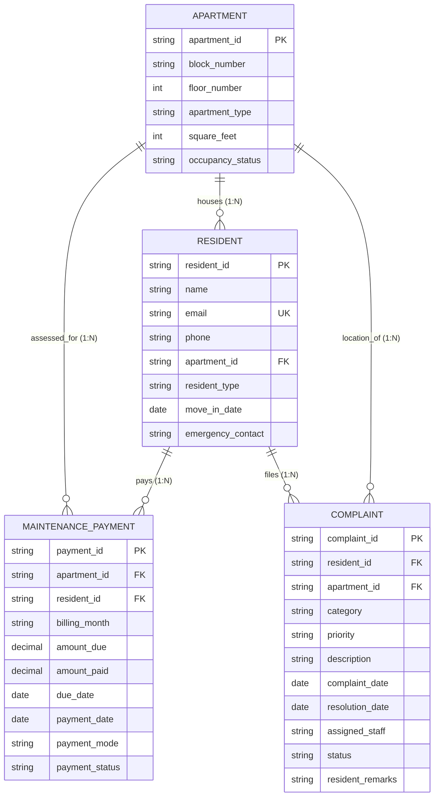

# Database Design, Relational Model, and Normalization
## Apartment Maintenance and Resident Complaint Management System
**Course Alignment:** 25ITT31 - Database Management Systems (Units 1, 2, 3 & 4)  
**Scenario:** 18 (Apartment Maintenance and Resident Complaint Management System)

---

## 1. Entity-Relationship (ER) Model

### 1.1 Entities and Attributes
1. **APARTMENT (Strong Entity)**
   * `apartment_id` (Primary Key, VARCHAR(10))
   * `block_number` (VARCHAR(10))
   * `floor_number` (INT)
   * `apartment_type` (VARCHAR(20))
   * `square_feet` (INT)
   * `occupancy_status` (VARCHAR(25))

2. **RESIDENT (Strong Entity)**
   * `resident_id` (Primary Key, VARCHAR(10))
   * `name` (VARCHAR(100))
   * `email` (Candidate Key / Unique, VARCHAR(100))
   * `phone` (VARCHAR(20))
   * `apartment_id` (Foreign Key $\to$ APARTMENT)
   * `resident_type` (VARCHAR(20))
   * `move_in_date` (DATE)
   * `emergency_contact` (VARCHAR(20))

3. **MAINTENANCE_PAYMENT (Entity)**
   * `payment_id` (Primary Key, VARCHAR(20))
   * `apartment_id` (Foreign Key $\to$ APARTMENT)
   * `resident_id` (Foreign Key $\to$ RESIDENT)
   * `billing_month` (VARCHAR(10))
   * `amount_due` (DECIMAL(10,2))
   * `amount_paid` (DECIMAL(10,2))
   * `due_date` (DATE)
   * `payment_date` (DATE)
   * `payment_mode` (VARCHAR(30))
   * `payment_status` (VARCHAR(20))

4. **COMPLAINT (Entity)**
   * `complaint_id` (Primary Key, VARCHAR(20))
   * `resident_id` (Foreign Key $\to$ RESIDENT)
   * `apartment_id` (Foreign Key $\to$ APARTMENT)
   * `category` (VARCHAR(50))
   * `priority` (VARCHAR(20))
   * `description` (TEXT)
   * `complaint_date` (DATE)
   * `resolution_date` (DATE)
   * `assigned_staff` (VARCHAR(100))
   * `status` (VARCHAR(20))
   * `resident_remarks` (TEXT)

---

### 1.2 ER Diagram (Entity-Relationship Representation)

---

## 2. Relational Model & Schema Mapping

The conceptual ER model maps directly into four normalized relational tables with clear primary key (PK) and foreign key (FK) referential integrity rules:

$$\text{APARTMENTS}(\underline{\text{apartment\_id}}, \text{block\_number}, \text{floor\_number}, \text{apartment\_type}, \text{square\_feet}, \text{occupancy\_status})$$

$$\text{RESIDENTS}(\underline{\text{resident\_id}}, \text{name}, \text{email}, \text{phone}, \text{apartment\_id}^*, \text{resident\_type}, \text{move\_in\_date}, \text{emergency\_contact})$$
$$\text{Where } \text{apartment\_id}^* \text{ references } \text{APARTMENTS}(\text{apartment\_id})$$

$$\text{MAINTENANCE\_PAYMENTS}(\underline{\text{payment\_id}}, \text{apartment\_id}^*, \text{resident\_id}^*, \text{billing\_month}, \text{amount\_due}, \text{amount\_paid}, \text{due\_date}, \text{payment\_date}, \text{payment\_mode}, \text{payment\_status})$$
$$\text{Where } \text{apartment\_id}^* \text{ references } \text{APARTMENTS}(\text{apartment\_id}), \text{resident\_id}^* \text{ references } \text{RESIDENTS}(\text{resident\_id})$$

$$\text{COMPLAINTS}(\underline{\text{complaint\_id}}, \text{resident\_id}^*, \text{apartment\_id}^*, \text{category}, \text{priority}, \text{description}, \text{complaint\_date}, \text{resolution\_date}, \text{assigned\_staff}, \text{status}, \text{resident\_remarks})$$
$$\text{Where } \text{resident\_id}^* \text{ references } \text{RESIDENTS}(\text{resident\_id}), \text{apartment\_id}^* \text{ references } \text{APARTMENTS}(\text{apartment\_id})$$

---

## 3. Database Normalization Walkthrough

To eliminate data redundancy, prevent update, insertion, and deletion anomalies, and guarantee data consistency, the relational schema was designed through rigorous normalization from Unnormalized Form (UNF) through First (1NF), Second (2NF), Third (3NF), and Boyce-Codd Normal Form (BCNF).

### 3.1 Unnormalized Form (UNF) Problem
In a single unnormalized flat ledger:
$$\text{APARTMENT\_LEDGER}(\text{AptID}, \text{Block}, \text{Type}, \text{ResidentID}, \text{ResidentName}, \text{Phone}, \text{Month}, \text{Amount}, \text{ComplaintIDs}, \dots)$$
* **Anomalies Encountered:**
  * **Insertion Anomaly:** Cannot record a new vacant apartment without inventing dummy resident data.
  * **Update Anomaly:** If a resident changes phone number, dozens of historical monthly payment entries and complaint rows must be updated.
  * **Deletion Anomaly:** Deleting a resolved complaint may unintentionally erase resident contact details.
  * **Multi-valued Attributes:** `ComplaintIDs` contains comma-separated lists of values.

---

### 3.2 First Normal Form (1NF)
* **Rule:** A relation is in 1NF if and only if all attribute values are atomic (no repeating groups, no comma-separated arrays, no nested tables) and each record is uniquely identifiable by a primary key.
* **Transformation:**
  * Multi-valued complaints and recurring monthly payments are decomposed into distinct rows with scalar values.
  * Defined primary keys: `apartment_id`, `resident_id`, `payment_id`, `complaint_id`.
  * Status: **1NF Satisfied.**

---

### 3.3 Second Normal Form (2NF)
* **Rule:** A relation is in 2NF if it is in 1NF and no non-prime attribute is partially dependent on any proper subset of any candidate key (no partial functional dependency).
* **Analysis:**
  * In our decomposed entities, all primary keys are single-attribute keys:
    * $\text{APARTMENTS}: \{\text{apartment\_id}\}$
    * $\text{RESIDENTS}: \{\text{resident\_id}\}$
    * $\text{MAINTENANCE\_PAYMENTS}: \{\text{payment\_id}\}$
    * $\text{COMPLAINTS}: \{\text{complaint\_id}\}$
  * Since no table has a composite primary key, partial functional dependency is mathematically impossible.
  * Status: **2NF Satisfied.**

---

### 3.4 Third Normal Form (3NF)
* **Rule:** A relation is in 3NF if it is in 2NF and there are no transitive functional dependencies of non-prime attributes on candidate keys (for every non-trivial functional dependency $X \to Y$, either $X$ is a superkey or $Y$ is a prime attribute).
* **Analysis:**
  * In `RESIDENTS`:
    * $\text{resident\_id} \to \{\text{name}, \text{email}, \text{phone}, \text{apartment\_id}, \text{resident\_type}, \text{move\_in\_date}, \text{emergency\_contact}\}$
    * No non-key attribute determines another non-key attribute.
  * In `MAINTENANCE_PAYMENTS`:
    * $\text{payment\_id} \to \{\text{apartment\_id}, \text{resident\_id}, \text{billing\_month}, \text{amount\_due}, \text{amount\_paid}, \text{due\_date}, \text{payment\_date}, \text{payment\_mode}, \text{payment\_status}\}$
    * Resident name, apartment block, and phone are intentionally **not stored** here (they are fetched dynamically via foreign keys and SQL Joins), eliminating transitive dependency.
  * In `COMPLAINTS`:
    * $\text{complaint\_id} \to \{\text{resident\_id}, \text{apartment\_id}, \text{category}, \text{priority}, \text{description}, \text{complaint\_date}, \text{status}, \dots\}$
    * No transitive dependencies exist.
  * Status: **3NF Satisfied.**

---

### 3.5 Boyce-Codd Normal Form (BCNF)
* **Rule:** A relation is in BCNF if for every non-trivial functional dependency $X \to Y$, $X$ is a superkey.
* **Verification:**
  1. `APARTMENTS`: 
     * Key: `apartment_id`. Any determinant is a superkey. $\implies$ **BCNF**.
  2. `RESIDENTS`: 
     * Keys: `resident_id` (Primary), `email` (Alternate candidate key).
     * Since both `resident_id` and `email` are superkeys, every functional dependency has a superkey as determinant. $\implies$ **BCNF**.
  3. `MAINTENANCE_PAYMENTS`: 
     * Key: `payment_id`. Determinant is superkey. $\implies$ **BCNF**.
  4. `COMPLAINTS`: 
     * Key: `complaint_id`. Determinant is superkey. $\implies$ **BCNF**.

**Conclusion:** The database schema is strictly in **Boyce-Codd Normal Form (BCNF)**, guaranteeing lossless joins and complete dependency preservation.

---

## 4. Query Optimization & Indexing Strategies (DBMS Unit 3)
To ensure optimal performance under high concurrency:
1. **B-Tree Index on Foreign Keys:**
   * `CREATE INDEX idx_resident_apartment ON residents(apartment_id);`
   * Accelerates join operations between units and occupant profiles.
2. **Filtered Status Indexing:**
   * `CREATE INDEX idx_payment_status ON maintenance_payments(payment_status);`
   * Directly targets overdue and pending accounts without table scans.
3. **Complaint Workflow Indexing:**
   * `CREATE INDEX idx_complaint_status ON complaints(status);`
   * Optimizes active ticket queries for maintenance staff dispatch.
