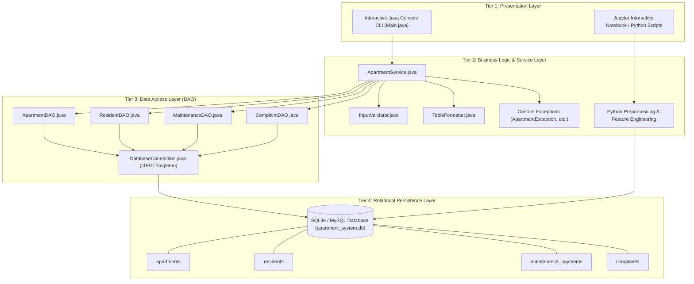
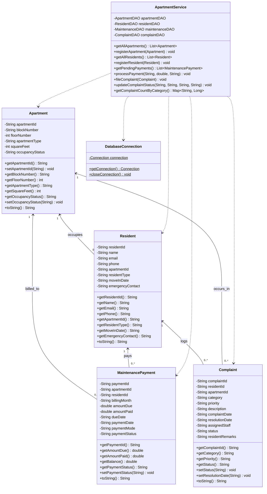
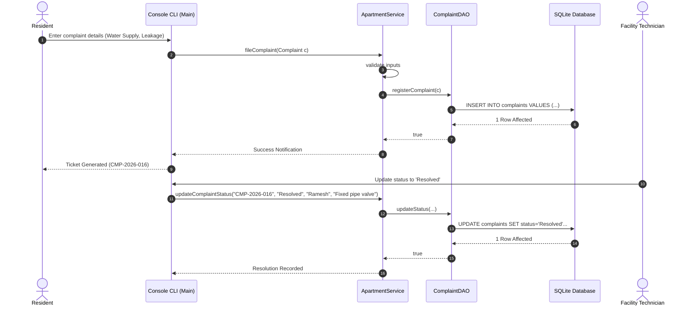

# System Design and UML Diagrams
## Apartment Maintenance and Resident Complaint Management System
**Course Alignment:** 25ITT33 - Software Engineering (Units 2 & 3)  
**Scenario:** 18 (Apartment Maintenance and Resident Complaint Management System)

---

## 1. System Architecture Overview
The system follows a classic **3-Tier Layered Architecture** augmented with an **Exploratory Data Science & Visualizations Engine**.



---

## 2. Use Case Diagram

### 2.1 Actors
1. **Resident:** Submits grievances, checks apartment details, reviews maintenance dues.
2. **Apartment Administrator:** Manages apartment units, assigns residents, oversees monthly billing, reviews financial reports.
3. **Maintenance Supervisor / Technician:** Reviews assigned service complaints, updates progress, marks complaints resolved.
4. **Data Analyst / Auditor:** Executes Python analytics, examines facility health trends and payment recovery metrics.

### 2.2 Use Case Diagram (Mermaid)

```mermaid
usecaseDiagram
    actor Resident as "Resident"
    actor Admin as "Apartment Admin"
    actor Staff as "Maintenance Staff"
    actor Analyst as "Data Analyst"

    package "Apartment Management System" {
        usecase UC1 as "Register Apartment Unit"
        usecase UC2 as "Manage Resident Profiles"
        usecase UC3 as "Generate Maintenance Bills"
        usecase UC4 as "Record Maintenance Payment"
        usecase UC5 as "View Outstanding Dues"
        usecase UC6 as "Register Facility Complaint"
        usecase UC7 as "Track & Update Complaint Status"
        usecase UC8 as "View Category-wise Reports"
        usecase UC9 as "Run EDA & Generate Visualizations"
    }

    Admin --> UC1
    Admin --> UC2
    Admin --> UC3
    Admin --> UC4
    Admin --> UC5
    Admin --> UC8

    Resident --> UC4
    Resident --> UC5
    Resident --> UC6

    Staff --> UC7
    Staff --> UC8

    Analyst --> UC9
    Analyst --> UC8
```

### 2.3 Detailed Use Case Specifications

| Use Case ID | Use Case Name | Primary Actor | Pre-conditions | Main Flow | Post-conditions |
|---|---|---|---|---|---|
| **UC-01** | Register Resident | Admin | Unit must exist and be vacant | Admin enters resident name, email, phone, moves in. | Unit status set to 'Occupied'. |
| **UC-02** | Record Payment | Admin / Resident | Pending bill exists | User provides Payment ID, amount, and mode. | Status changed to 'Paid', receipt logged. |
| **UC-03** | File Complaint | Resident | Resident is registered | Resident selects category, enters description & priority. | New ticket created in 'Open' state. |
| **UC-04** | Resolve Complaint| Staff / Admin | Ticket is Open / In Progress | Technician updates status to 'Resolved' with remarks. | Resolution date captured, ticket closed. |
| **UC-05** | Generate EDA | Data Analyst | Python environment active | Analyst runs `eda_visualization.py`. | 6 high-res PNG charts generated. |

---

## 3. Class Diagram

The class diagram below illustrates the Object-Oriented design implemented in Java, displaying classes, attributes, methods, access modifiers, and associations.



---

## 4. Sequence Diagrams

### 4.1 Complaint Registration and Resolution Flow

